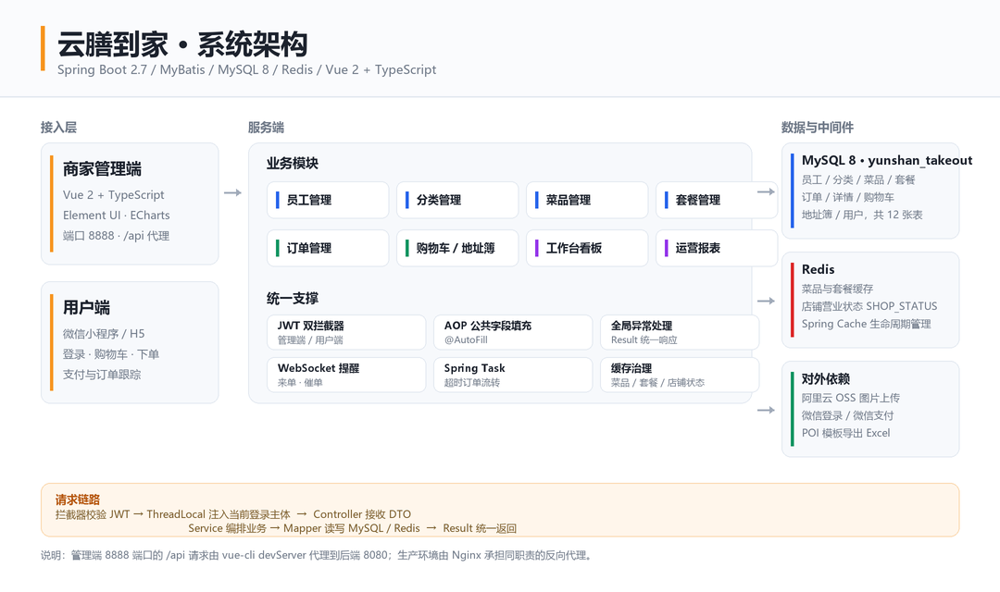

# 云膳到家 · 企业级外卖点餐平台

面向餐饮商户与消费者的外卖平台：一套 Spring Boot 多模块后端 + Vue 商家管理端，
覆盖 **员工 / 分类 / 菜品 / 套餐 / 订单 / 支付 / 数据统计** 的完整业务闭环。

## 系统架构



## 技术栈

| 层次 | 技术 |
| --- | --- |
| 后端框架 | Spring Boot 2.7、Spring MVC、MyBatis、Maven 多模块 |
| 数据库 | MySQL 8、Druid 连接池 |
| 缓存 | Redis、Spring Cache |
| 鉴权 | JWT、HandlerInterceptor、ThreadLocal |
| 实时通信 | WebSocket（来单提醒 / 客户催单） |
| 定时任务 | Spring Task（cron） |
| 文件与支付 | 阿里云 OSS、微信登录 / 微信支付、HttpClient |
| 报表 | Apache POI（Excel 模板导出）、Apache ECharts |
| 前端 | Vue 2 + TypeScript + Element UI + ECharts |
| 部署 | Nginx 反向代理 |

## 功能模块

- **管理端（admin-frontend）**：员工管理、分类管理、菜品管理、套餐管理、店铺营业状态、订单管理、工作台看板、运营数据统计与 Excel 报表导出
- **用户端（接口）**：微信登录、商品浏览、购物车、地址簿、下单、订单支付与回调、订单状态跟踪
- **平台能力**：图片上传（OSS）、来单语音提醒、客户催单、超时订单与派送中订单定时处理
- **🤖 经营助手 Agent**：数据驱动的经营诊断（营业额环比 / 订单状态 / 菜品在售）+ 关键词智能问答，管理端新增「经营助手」菜单

## 关键实现

- **登录鉴权**：JWT 签发与校验 + 管理端 / 用户端双拦截器，登录态通过 `ThreadLocal` 在请求上下文内透传
- **公共字段自动填充**：自定义注解 + AOP 切面统一填充 `create_time` / `update_time` / `create_user` / `update_user`
- **缓存**：Redis 缓存菜品与套餐数据，写操作后主动清理；套餐列表由 Spring Cache 管理生命周期
- **实时提醒**：`WebSocketServer` 推送来单与催单消息，`WebSocketTask` 定时推送
- **定时任务**：`OrderTask` 基于 cron 处理超时未支付订单与派送中订单的状态流转
- **报表导出**：基于 POI 模板写入运营数据，ECharts 展示营业额 / 订单 / 用户统计

## 目录结构

```
yunshan-takeout
├── backend                     # 后端 Maven 多模块工程
│   ├── yunshan-common          # 通用工具、常量、异常、上下文、配置属性
│   ├── yunshan-pojo            # Entity / DTO / VO
│   └── yunshan-server          # Controller / Service / Mapper / 配置 / 任务 / WebSocket / agent(经营助手)
├── admin-frontend              # 商家管理端（Vue 2 + TypeScript）
├── sql                         # 数据库脚本
└── README.md
```

## 本地运行

前置：JDK 8+、Maven 3.6+、MySQL 8、Redis、Node 14+（前端）

1. **数据库**：新建 `yunshan_takeout` 库并导入脚本

   ```bash
   mysql -uroot -p < sql/yunshan_takeout.sql
   ```

2. **配置**：`backend/yunshan-server/src/main/resources/application-dev.yml`
   - 数据库：`yunshan_takeout`，默认 `root / 1234`
   - Redis：`localhost:6379`，`database: 10`，无密码
   - OSS / 微信支付：仍为占位值，用到上传与支付时需替换为自己的凭证

3. **后端**：`cd backend && mvn clean package`，运行 `com.yunshan.YunshanApplication`，端口 **8080**

4. **前端**：`cd admin-frontend && npm install && npm run serve`，开发端口 **8888**（`/api` 已代理到 `localhost:8080`）

5. **接口文档**：启动后访问 <http://localhost:8080/doc.html>

6. **登录账号**：`admin / 123456`（默认门店 1 号店）

## 说明

- 菜品图片仍指向公共图床，未随仓库迁移；如需完全私有化，可替换 `sql` 中的图片地址并结合 OSS 上传功能。
- OSS、微信登录 / 微信支付凭证为占位值，未配置时不影响除上传、支付以外的功能。
- 前端已移除 `fibers`（原生模块在新版本 Node 上无法编译），样式编译改用 dart-sass，功能等价。
